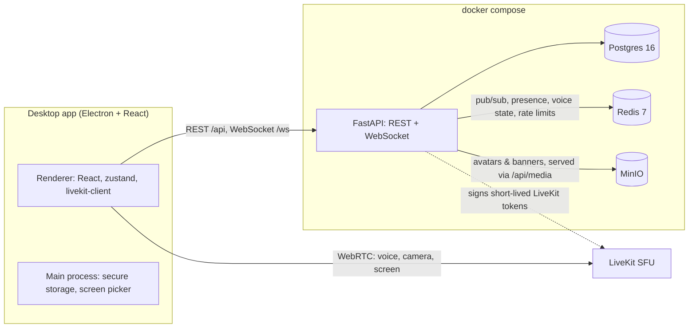

# Aureum Voice

A small, self-hosted Discord-style app for a group of friends: text channels, voice channels with
camera, and **screen sharing with system audio** (the game's sound, without echoing the call back).

Built as a desktop app (Electron + React) on top of a FastAPI backend and [LiveKit](https://livekit.io)
for real-time media. The whole stack is open source and designed to run at zero cost.

## Features

- Email + password accounts (Argon2, short-lived JWT access tokens + refresh tokens kept in the OS
  keychain via Electron `safeStorage`)
- Invite-only sign-up: a new account needs an invite code, which also puts the user in that server
- Servers with an icon and an animated banner, text and voice channels, invites with expiry and use limits
- Roles with a color, an icon and 24 permissions, ranked by drag and drop: nobody manages a role or a
  member at or above their own, and per-channel overrides (allow / inherit / deny) for roles and members.
  A channel, room or add-on can be created private, open only to picked roles and members, with a lock
  in the sidebar; whoever can't see it doesn't get it anywhere (lists, history, feed, events, voice). The API checks every route and WebSocket event, and LiveKit tokens only allow what the member
  may publish. Kick and ban from the server settings
  ([ADR 0007](docs/decisions/0007-roles-and-permissions.md))
- Per-server nicknames, and voice moderation: server mute, server deafen and moving people between
  rooms, enforced on the media server too through LiveKit's server API
  ([ADR 0009](docs/decisions/0009-call-audio-moderation-and-menus.md))
- Right-click menus on people, channels and servers. Each shows only what the user is allowed to do:
  profile, message, call, friendship, volume, nickname, roles, moderation, kick and ban, mark as read,
  silence, settings, invite, copy ID. A person has the same menu wherever they appear: chat authors and
  @mentions, member lists, call tiles, people under rooms, DMs, group members, "Active now" and the
  profile card. Conversations in the DM list add mark as read, silence and close, and groups also add
  rename, change picture and leave
- Group DMs with a picture and a member list beside the conversation
- A collapsible member list grouped by the roles shown separately, with offline members at the end
- Real-time chat (send, edit, delete) shown as bubbles, presence and voice state over a single WebSocket
- Files in channels, DMs and groups: the "+" button, drag and drop, or paste an image. Several files per
  message, with upload progress. Images open in a full-screen viewer with zoom, videos play inline, and
  anything else is a card with a download button. Up to `MAX_ATTACHMENT_MB` (25 MB) each. Downloads
  need a token and access to the conversation, and the app caches what it already fetched (memory +
  disk, wiped on logout) ([ADR 0015](docs/decisions/0015-attachments-and-background.md))
- Runs in the background: closing the window keeps it connected in the Windows tray (open, mute,
  deafen, status, quit). It starts with Windows hidden in the tray, only one copy runs at a time, and
  Settings > Windows changes both
- Unread counters and `@username` mention badges per channel, synced across devices
- Friends by `@username` (requests, accept / decline / cancel, unfriend, block), DMs and group DMs of up
  to 10 people, and an "Active now" list of friends in calls with a join button
- Private calls in DMs and groups: the other members get an incoming-call popup with a ringtone for
  30 s, a missed call stays in the chat and in notifications, and more people can be added mid-call
  (from a 1:1 DM the call moves to a new group, so the DM's history stays private)
  ([ADR 0006](docs/decisions/0006-friends-dms-and-private-calls.md))
- Presence: online, idle (automatic after 10 minutes without input on the PC), do not disturb
  (silences the ringtone) and invisible
- An app shell of its own, with no system title bar: the tab bar is the top of the window (its empty
  parts move it) and Windows' buttons are drawn over it in the theme's colors:
  - a tab bar with Home and one tab per open server (drag to reorder, close and reopen);
  - a sidebar that follows the tab, with rooms, conversations and add-ons, collapsible to icons;
  - up to two panels side by side, each with its own tabs.
  
  The layout follows the user to any PC ([ADR 0005](docs/decisions/0005-app-shell-panels-and-read-state.md)).
  Columns resize by dragging, with sizes saved per user too. The overview tab is pinned first, and
  hovering a server tab previews its banner and who's online and in calls.
- A server overview showing who's in which room and live screen thumbnails (low-res JPEGs over the
  API WebSocket, so watching costs no media bandwidth), unread news grouped by channel, and the
  members, online first
- A call panel at the bottom of the sidebar for the whole call (who's in it, who's talking, mic, deafen,
  camera, screen, leave), people listed under each room, and an optional floating call window that
  snaps to any corner; the call expands into a panel or fullscreen
- Voice channels with camera, speaking indicator, mute / deafen, and device selection
- Each person's volume from 0 to 200% and a local mute, saved per user
- Local mic noise suppression with RNNoise (WebAssembly), free and on by default
  ([ADR 0008](docs/decisions/0008-noise-suppression.md))
- Grid and Focus call layouts (click any tile to focus it), several live screens at once with per-stream
  volume and fullscreen; simulcast + adaptive stream keep each viewer's download to what is on screen
  ([ADR 0004](docs/decisions/0004-call-layout-and-bandwidth.md))
- An in-game overlay with who's in the call, who's talking, who's muted and (optionally) cameras. It's a
  transparent, click-through window over games in **windowed or borderless mode** (exclusive fullscreen
  isn't supported, and nothing is injected into the game, so anti-cheats have nothing to flag). It hides
  while Aureum is focused and stays out of screenshots and screen shares. Ctrl+Shift+F9 hides or shows
  it and Ctrl+Shift+F10 enters edit mode to drag and resize it; both can be changed. They also work in
  games that block Windows hotkeys (such as League of Legends). During a call with the overlay on, the
  app reads only those shortcuts' keys, never any other key, and records nothing. Size, opacity and
  "only who's speaking" are in Settings > Overlay ([ADR 0012](docs/decisions/0012-in-game-overlay.md))
- Screen and window sharing with a custom picker and **system audio loopback** on Windows; the call's
  own audio is excluded from the capture ([ADR 0002](docs/decisions/0002-screen-share-system-audio.md))
- Streaming quality decided by the server: the voice token carries the user's media tier (free: camera
  and screen up to 720p, 30 fps), and the screen picker offers **Texto nítido** (15 fps, keeps
  resolution) or **Movimento** (30 fps, keeps frame rate). Simulcast still sends smaller layers to small
  tiles. Groundwork for a paid plan later ([ADR 0017](docs/decisions/0017-media-tiers.md))
- Profiles with animated avatars and banners (PNG / JPEG / GIF / WebP, up to 8 MB), bio, profile color,
  pronouns, an avatar frame, a profile song, up to 5 links and badges. The profile card also shows
  "Now", roles in the current server and Message / Call buttons, and Settings has a live preview
- Badges: hexagons whose metal shows the rarity (common, rare, legendary, mythic), with a tooltip and a
  number on numbered ones. Mythic ones glow and shine. Beta badges (Fundador, Pioneiro #N) are given
  only while the beta runs, Caçador de bugs when a reported problem is resolved
  ([ADR 0018](docs/decisions/0018-pre-beta.md))
- Voice messages: hold the mic button in the message field (or click it) to record up to 5 minutes of
  Opus/WebM. The player shows the waveform, the time and 1x/1.5x/2x speed
- Push-to-talk with a key or a side mouse button that works in the background and in games, reading
  only that key and only during a call
- Automatic updates from GitHub releases, and **Reportar problema** (profile menu or Ctrl+Shift+R): a
  description, the version, the OS, recent logs with tokens removed and, only if ticked after a preview,
  a screenshot of the window. The app owner reads them in Settings
- A custom status with an emoji and an expiry, shown as a bubble next to the avatar in member lists, the
  profile card and call tiles
- Automatic "Jogando X": the app spots open games from a bundled list plus games the user adds, and sends
  only the game's name. It can be turned off, games can be hidden, and a manual activity can be set
  ([ADR 0010](docs/decisions/0010-rich-profiles-and-game-activity.md))
- Add-ons that run in their own channels. Adding one takes the Manage add-ons permission, and each
  add-on is an isolated module in the API (its own router, tables and Alembic branch) and in the app.
  ([ADR 0013](docs/decisions/0013-addon-framework.md)). The first one is a Kanban board: columns,
  cards with assignee, labels and due dates, drag and drop, live updates, a change history and a
  progress card on the server overview. Card moves can be announced as system lines in a chosen
  text channel, with a warning when that channel is seen by people who can't see the board
  ([ADR 0014](docs/decisions/0014-kanban-addon.md))
- Dark and light themes (or follow Windows) and a custom accent color, saved per user on the server; text
  on and in the accent keeps WCAG AA contrast automatically ([ADR 0003](docs/decisions/0003-design-tokens-and-themes.md))

## Architecture



- **API** (`apps/api`): Python 3.12, FastAPI, async SQLAlchemy 2 + Alembic, Pydantic v2. Events are
  published to Redis and fanned out to each user's WebSocket connections, so the API can scale past one
  process. Presence and voice state live in Redis with heartbeats and TTLs. Voice state is kept per
  scope: a server's rooms, or a DM/group's private call, so both use the same voice flow.
- **Add-ons**: each one is a package in `apps/api/app/addons/<key>` and a folder in
  `apps/desktop/src/renderer/src/addons/<key>`. Add-on code reaches channels only through a shared
  helper that checks permissions, so add-ons never reimplement access control. Their migrations are
  separate Alembic branches, applied with `alembic upgrade heads`. Add-on tables hang off a generic
  `workspace_id`, so an add-on like the Kanban board doesn't depend on servers or channels.
- **Media**: the API issues a LiveKit token per voice channel (room = channel id, identity = user id) and
  returns the LiveKit URL with it, so the desktop app holds no media secrets. LiveKit can be self-hosted
  (included in compose) or LiveKit Cloud.
- **Files**: uploads are checked by magic bytes, stored in MinIO, and served through the API. MinIO is
  never exposed.
- **Desktop** (`apps/desktop`): electron-vite, React 19, TypeScript, Tailwind 4. Context isolation and
  sandboxing are on; IPC is restricted to the app's own window. All colors come from theme tokens (CSS
  variables) and the stock Tailwind palette is disabled; Sora and Figtree are bundled with the app.

Design decisions are recorded in [`docs/decisions`](docs/decisions).

## Repository layout

```
apps/api/        FastAPI app, Alembic migrations, pytest suite
apps/desktop/    Electron + React desktop app
scripts/         generate-sounds.mjs, which synthesizes the UI sounds
infra/           docker-compose files and LiveKit config
docs/decisions/  architecture decision records
.env.example     every setting the stack reads
```

## Running locally

Requirements: Docker Desktop, Node.js 22+, and Python 3.12 (only to run the API tests from the host).

1. **Configure.** Copy `.env.example` to `.env` and replace every `change-me` value with a strong random
   secret. `.env` is git-ignored; secrets never go anywhere else.

2. **Start the stack** (from the repository root). The dev override publishes Postgres, Redis and MinIO on
   `127.0.0.1` and the `local-livekit` profile runs LiveKit in a container:

   ```sh
   docker compose --env-file .env -f infra/docker-compose.yml -f infra/docker-compose.dev.yml --profile local-livekit up -d --wait
   ```

   The API runs its migrations on startup and listens on `http://127.0.0.1:8000`
   (`/api/health`, interactive docs at `/api/docs`).

3. **Run the desktop app:**

   ```sh
   cd apps/desktop
   npm install
   npm run dev
   ```

   The first account can be created without an invite; after that, sign-up requires an invite code
   (create a server, then use **Convidar pessoas** in the server menu).

### Tests

The API suite runs against real Postgres, Redis and MinIO, using a separate `aureum_test` database,
`aureum-test` bucket and Redis prefix. The simplest way runs it in a throwaway container on the
stack's network, so it works in dev or plan B mode without publishing ports or restarting anything
(the stack must be up). Extra arguments go to pytest:

```sh
node scripts/test-api.mjs
node scripts/test-api.mjs tests/test_attachments.py -x
```

With the stack in dev mode (ports published on 127.0.0.1) it can also run from a local venv:

```sh
cd apps/api
python -m venv .venv
.venv/Scripts/pip install -r requirements-dev.txt   # .venv/bin/pip on Linux/macOS
.venv/Scripts/python -m pytest
```

For the desktop app, `npm run typecheck` checks the main and renderer processes, and `npm test` runs
the component tests (Vitest + Testing Library in jsdom, no server needed).

### Sounds

The UI sounds (`apps/desktop/src/renderer/src/assets/sounds/*.ogg`) are synthesized by
`scripts/generate-sounds.mjs` and committed, so ffmpeg is only needed to change them. To regenerate,
install ffmpeg (`winget install ffmpeg` on Windows), edit the sound's entry in the script, and run:

```sh
cd apps/desktop
npm run sounds            # all sounds
npm run sounds -- message # only the named ones
```

Output is byte-identical between runs, so git only shows the sounds that actually changed. The sounds
are © Aureum, all rights reserved (see `docs/sounds/LICENSES.md`).

### Admin commands

Run inside the API container, from the repository root:

```sh
docker compose --env-file .env -f infra/docker-compose.yml exec api python -m app.cli users create aureum --email <e-mail> --display-name Aureum
docker compose --env-file .env -f infra/docker-compose.yml exec api python -m app.cli badges list <username>
docker compose --env-file .env -f infra/docker-compose.yml exec api python -m app.cli badges grant <username> bug_hunter
```

`users create` makes accounts sign-up refuses (reserved names such as `aureum`, `admin` or `suporte`)
and asks for the password. `AUREUM_OWNER_USERNAME` in `.env` names the owner's account, which reads the
problems reported from the app (Settings > Problemas) and gets the Founder badge. `AUREUM_BETA=true`
gives new sign-ups the numbered beta badge.

### Building the Windows installer

```sh
cd apps/desktop
echo MAIN_VITE_API_URL=https://your-server.example > .env.production.local
npm run build:win
```

The installer is written to `apps/desktop/release/`. `MAIN_VITE_API_URL` is the server the app points to
by default; users can still change it on the sign-in screen. The installer is not code-signed, so Windows
SmartScreen shows a warning on first run (**More info → Run anyway**).

Installed apps update themselves from this repository's GitHub releases (checked at startup and every
6 hours, on the channel of the version, e.g. `beta`). To ship an update, raise `version` in
`apps/desktop/package.json` (e.g. `0.2.0-beta.2`), put a `GH_TOKEN` in the root `.env` (a fine-grained
token for this repository with "Contents: read and write"), then:

```sh
cd apps/desktop
npm run release
```

That uploads a **draft** release; it reaches people only after you publish it on GitHub.

## Hosting

### Temporary deployment (plan B)

While the permanent server is not available, the app runs from a home PC at no cost:

- **Media** goes through **LiveKit Cloud** on the free plan. Its monthly quota is a hard cap, so running out
  only makes calls fail until the next month; nothing is ever billed.
- **API, Postgres, Redis and MinIO** run with docker compose on the PC. Only the API publishes a port, and
  only on `127.0.0.1`.
- **Public access** comes from **[Tailscale Funnel](https://tailscale.com/kb/1223/funnel)** (free), which
  gives the API a public HTTPS address on port 443 (`https://<machine>.<tailnet>.ts.net`). Nothing else on
  the PC is reachable.
- Friends only install the app; the installer is built with the Funnel address as its default server.

Hardening that is in place before exposing anything:

- sign-up requires an invite code, and only server owners and admins can create invites
- login and sign-up are rate limited per client IP (the proxy's `X-Forwarded-For` is trusted only because
  the API port is bound to localhost) and per account for failed logins
- CORS and WebSocket `Origin` checks only accept the desktop app
- all secrets live in `.env`, which is git-ignored

**Set up**

1. Put the LiveKit Cloud project URL (`wss://<project>.livekit.cloud`), API key and secret in `.env` as
   `LIVEKIT_URL`, `LIVEKIT_API_KEY` and `LIVEKIT_API_SECRET`.
2. Start the stack without the dev override or local LiveKit:

   ```sh
   docker compose --env-file .env -f infra/docker-compose.yml up -d --wait
   ```

3. Turn on Funnel for the API (on Windows the CLI is `"C:\Program Files\Tailscale\tailscale.exe"`). The
   first time, Tailscale asks you to enable HTTPS certificates and Funnel for the tailnet in its admin
   console.

   ```sh
   tailscale funnel --bg 8000      # expose 127.0.0.1:8000 at https://<machine>.<tailnet>.ts.net (persists across reboots)
   tailscale funnel status         # show the public address
   tailscale funnel --https=443 off  # stop exposing the API
   tailscale funnel reset          # remove all serve/funnel configuration
   ```

4. Build the installer with `MAIN_VITE_API_URL` set to the Funnel address and share it with your friends.

To go back to fully local development, run `docker compose ... down` for the plan B stack and start it again
with the dev override and `--profile local-livekit`. The data volumes are shared between both modes.

### Permanent deployment

The target is an Oracle Cloud Always Free VM running the whole stack, including a self-hosted LiveKit, behind
Caddy with automatic HTTPS. Plan B adds no dependency that prevents moving there: the desktop app gets the
LiveKit URL from the API, and the API URL is only a build setting.

## Roadmap

- Role mentions: the permission already exists
- The app's own sound set
- Add-ons: "watch together" (postponed until after the beta), later a BlueMap
  Minecraft map and listening to music together
- Sign in with Google and Discord (the `oauth_accounts` table is already in the schema)
