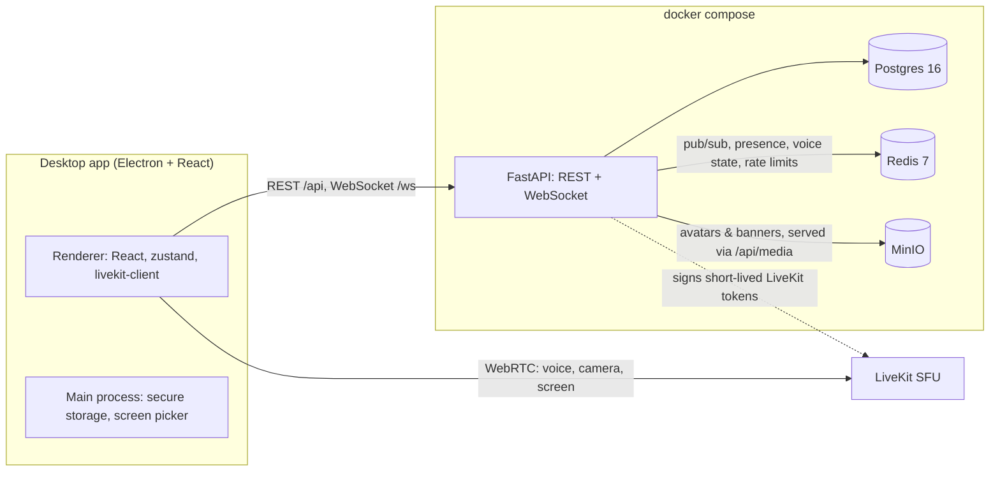

# Aureum Voice

A small, self-hosted Discord-style app for a group of friends: text channels, voice channels with
camera, and **screen sharing with system audio** (the game's sound, without echoing the call back).

Built as a desktop app (Electron + React) on top of a FastAPI backend and [LiveKit](https://livekit.io)
for real-time media. The whole stack is open source and designed to run at zero cost.

## Features

- Email + password accounts (Argon2, short-lived JWT access tokens + refresh tokens kept in the OS
  keychain via Electron `safeStorage`)
- Invite-only sign-up: a new account needs an invite code, which also puts the user in that server
- Servers, text and voice channels, invites with expiry and use limits, roles (owner / admin / member)
- Real-time chat (send, edit, delete) shown as bubbles, presence and voice state over a single WebSocket
- Unread counters and `@username` mention badges per channel, synced across devices
- Friends by `@username` (requests, accept / decline / cancel, unfriend, block), DMs and group DMs of up
  to 10 people, and an "Active now" list of friends in calls with a join button
- Private calls in DMs and groups: the other members get an incoming-call popup with a ringtone for
  30 s, a missed call stays in the chat and in notifications, and more people can be added mid-call
  (from a 1:1 DM the call moves to a new group, so the DM's history stays private)
  ([ADR 0006](docs/decisions/0006-friends-dms-and-private-calls.md))
- Presence: online, idle (automatic after 10 minutes without input on the PC), do not disturb
  (silences the ringtone) and invisible
- An app shell of its own:
  - a tab bar with Home and one tab per open server (drag to reorder, close and reopen);
  - a sidebar that follows the tab, with rooms, conversations and add-ons, collapsible to icons;
  - up to two panels side by side, each with its own tabs.
  
  The layout follows the user to any PC ([ADR 0005](docs/decisions/0005-app-shell-panels-and-read-state.md)).
- A server overview showing who's in which room and live screen thumbnails (low-res JPEGs over the
  API WebSocket, so watching costs no media bandwidth), unread news and who's online
- A floating call window that snaps to any corner and minimizes to the sidebar; the call expands
  into a panel or fullscreen
- Voice channels with camera, speaking indicator, mute / deafen, and device selection with noise suppression
- Grid and Focus call layouts (click any tile to focus it), several live screens at once with per-stream
  volume and fullscreen; simulcast + adaptive stream keep each viewer's download to what is on screen
  ([ADR 0004](docs/decisions/0004-call-layout-and-bandwidth.md))
- Screen and window sharing with a custom picker and **system audio loopback** on Windows; the call's
  own audio is excluded from the capture ([ADR 0002](docs/decisions/0002-screen-share-system-audio.md))
- Profiles with animated avatars and banners (PNG / JPEG / GIF / WebP, up to 8 MB), bio and profile color
- Dark and light themes (or follow Windows) and a custom accent color, saved per user on the server; text
  on and in the accent keeps WCAG AA contrast automatically ([ADR 0003](docs/decisions/0003-design-tokens-and-themes.md))

## Architecture



- **API** (`apps/api`): Python 3.12, FastAPI, async SQLAlchemy 2 + Alembic, Pydantic v2. Events are
  published to Redis and fanned out to each user's WebSocket connections, so the API can scale past one
  process. Presence and voice state live in Redis with heartbeats and TTLs. Voice state is kept per
  scope: a server's rooms, or a DM/group's private call, so both use the same voice flow.
- **Media**: the API issues a LiveKit token per voice channel (room = channel id, identity = user id) and
  returns the LiveKit URL with it, so the desktop app holds no media secrets. LiveKit can be self-hosted
  (included in compose) or LiveKit Cloud.
- **Files**: uploads are checked by magic bytes, stored in MinIO, and served through the API. MinIO is
  never exposed.
- **Desktop** (`apps/desktop`): electron-vite, React 19, TypeScript, Tailwind 4. Context isolation and
  sandboxing are on; IPC is restricted to the app's own window. All colors come from theme tokens (CSS
  variables) and the stock Tailwind palette is disabled; Sora and Figtree are bundled with the app.

Design decisions are recorded in [`docs/decisions`](docs/decisions).

## Repository layout

```
apps/api/        FastAPI app, Alembic migrations, pytest suite
apps/desktop/    Electron + React desktop app
infra/           docker-compose files and LiveKit config
docs/decisions/  architecture decision records
.env.example     every setting the stack reads
```

## Running locally

Requirements: Docker Desktop, Node.js 22+, and Python 3.12 (only to run the API tests from the host).

1. **Configure.** Copy `.env.example` to `.env` and replace every `change-me` value with a strong random
   secret. `.env` is git-ignored; secrets never go anywhere else.

2. **Start the stack** (from the repository root). The dev override publishes Postgres, Redis and MinIO on
   `127.0.0.1` and the `local-livekit` profile runs LiveKit in a container:

   ```sh
   docker compose --env-file .env -f infra/docker-compose.yml -f infra/docker-compose.dev.yml --profile local-livekit up -d --wait
   ```

   The API runs its migrations on startup and listens on `http://127.0.0.1:8000`
   (`/api/health`, interactive docs at `/api/docs`).

3. **Run the desktop app:**

   ```sh
   cd apps/desktop
   npm install
   npm run dev
   ```

   The first account can be created without an invite; after that, sign-up requires an invite code
   (create a server, then use **Convidar pessoas** in the server menu).

### Tests

The API suite runs against real Postgres, Redis and MinIO (in a separate `aureum_test` database and
bucket), so start the stack in dev mode first:

```sh
cd apps/api
python -m venv .venv
.venv/Scripts/pip install -r requirements-dev.txt   # .venv/bin/pip on Linux/macOS
.venv/Scripts/python -m pytest
```

For the desktop app, `npm run typecheck` checks both the main and renderer processes.

### Building the Windows installer

```sh
cd apps/desktop
echo MAIN_VITE_API_URL=https://your-server.example > .env.production.local
npm run build:win
```

The installer is written to `apps/desktop/release/`. `MAIN_VITE_API_URL` is the server the app points to
by default; users can still change it on the sign-in screen. The installer is not code-signed, so Windows
SmartScreen shows a warning on first run (**More info → Run anyway**).

## Hosting

### Temporary deployment (plan B)

While the permanent server is not available, the app runs from a home PC at no cost:

- **Media** goes through **LiveKit Cloud** on the free plan. Its monthly quota is a hard cap, so running out
  only makes calls fail until the next month; nothing is ever billed.
- **API, Postgres, Redis and MinIO** run with docker compose on the PC. Only the API publishes a port, and
  only on `127.0.0.1`.
- **Public access** comes from **[Tailscale Funnel](https://tailscale.com/kb/1223/funnel)** (free), which
  gives the API a public HTTPS address on port 443 (`https://<machine>.<tailnet>.ts.net`). Nothing else on
  the PC is reachable.
- Friends only install the app; the installer is built with the Funnel address as its default server.

Hardening that is in place before exposing anything:

- sign-up requires an invite code, and only server owners and admins can create invites
- login and sign-up are rate limited per client IP (the proxy's `X-Forwarded-For` is trusted only because
  the API port is bound to localhost) and per account for failed logins
- CORS and WebSocket `Origin` checks only accept the desktop app
- all secrets live in `.env`, which is git-ignored

**Set up**

1. Put the LiveKit Cloud project URL (`wss://<project>.livekit.cloud`), API key and secret in `.env` as
   `LIVEKIT_URL`, `LIVEKIT_API_KEY` and `LIVEKIT_API_SECRET`.
2. Start the stack without the dev override or local LiveKit:

   ```sh
   docker compose --env-file .env -f infra/docker-compose.yml up -d --wait
   ```

3. Turn on Funnel for the API (on Windows the CLI is `"C:\Program Files\Tailscale\tailscale.exe"`). The
   first time, Tailscale asks you to enable HTTPS certificates and Funnel for the tailnet in its admin
   console.

   ```sh
   tailscale funnel --bg 8000      # expose 127.0.0.1:8000 at https://<machine>.<tailnet>.ts.net (persists across reboots)
   tailscale funnel status         # show the public address
   tailscale funnel --https=443 off  # stop exposing the API
   tailscale funnel reset          # remove all serve/funnel configuration
   ```

4. Build the installer with `MAIN_VITE_API_URL` set to the Funnel address and share it with your friends.

To go back to fully local development, run `docker compose ... down` for the plan B stack and start it again
with the dev override and `--profile local-livekit`. The data volumes are shared between both modes.

### Permanent deployment

The target is an Oracle Cloud Always Free VM running the whole stack, including a self-hosted LiveKit, behind
Caddy with automatic HTTPS. Plan B adds no dependency that prevents moving there: the desktop app gets the
LiveKit URL from the API, and the API URL is only a build setting.

## Roadmap

- Server roles with permissions, server icons and banners
- Richer profiles and the app's own sound set
- In-game camera overlay
- Add-ons: a Kanban board and "watch together" first (shown as placeholders in the shell), later a
  BlueMap Minecraft map and listening to music together
- Sign in with Google and Discord (the `oauth_accounts` table is already in the schema)
