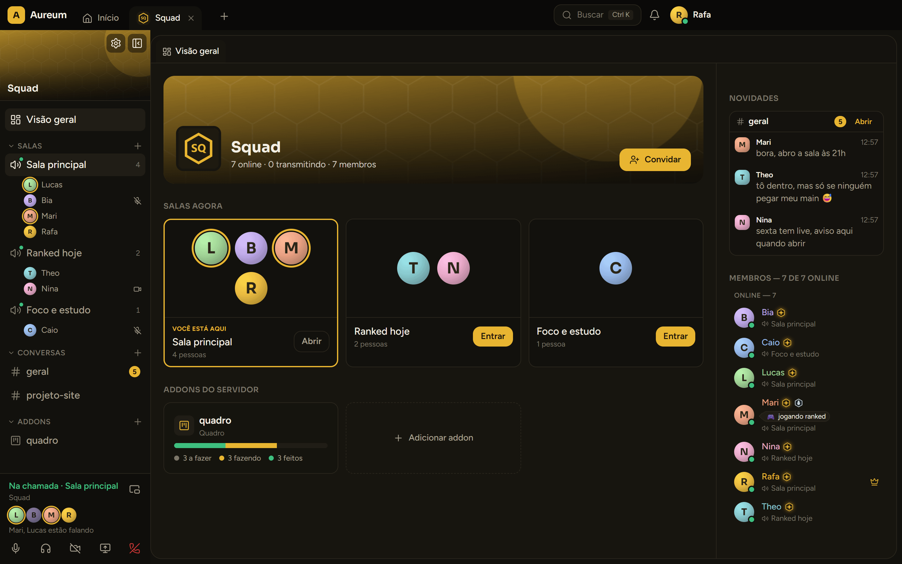

  

<h1 align="center">Aureum</h1>

  Voz, chat e quadros pra quem joga e trabalha junto. 
  <a href="https://eduoliveira1504.github.io/aureum-voice/"><b>eduoliveira1504.github.io/aureum-voice</b></a>

O Aureum é um app de conversa pra Windows, feito pra ficar aberto o dia todo com o seu grupo de
amigos ou o seu time:

- **Salas ao vivo:** a visão geral do servidor mostra quem está em cada sala e quem está falando, antes
  de você entrar.
- **Início:** um resumo do que importa agora: quem está em call, as menções e mensagens que você
  perdeu e as suas tarefas do Kanban, de todos os servidores.
- **Câmera e tela com áudio:** compartilhe a tela ou uma janela com o som do jogo junto.
- **Lado a lado:** chat e quadro Kanban na mesma tela.
- **Overlay nos jogos:** veja quem está falando sem sair da partida.
- **Do seu jeito:** avatar e banner animados, pronomes, insígnias e temas, tudo de graça.

Sem anúncio e sem IA dentro do app.

## Como entrar no beta

O beta é fechado: só entra quem tem convite.

1. **Pegue um convite** com alguém que já está dentro. Ele chega como um link do Aureum.
2. **Abra o link** pra criar a conta e confirmar o e-mail.
3. **Baixe o app** na [página do Aureum](https://eduoliveira1504.github.io/aureum-voice/) e entre com o
   seu e-mail. O Windows pode avisar que o app é desconhecido (ele ainda não tem assinatura digital):
   clique em **Mais informações** e depois em **Executar assim mesmo**.

Quem entra durante o beta ganha a insígnia **Pioneiro**, numerada na ordem de chegada.

O app se atualiza sozinho. Se o ícone antigo continuar aparecendo depois de uma atualização,
reinicie o PC (o Windows guarda o ícone em cache). As novidades de cada versão ficam no
[CHANGELOG](CHANGELOG.md).

Achou um problema? Use **Reportar problema** no app (Ctrl+Shift+R) ou
[abra uma issue](https://github.com/eduoliveira1504/aureum-voice/issues/new).

## Pra quem desenvolve

Arquitetura, como rodar localmente, testes e hospedagem: [docs/DEVELOPMENT.md](docs/DEVELOPMENT.md).
As decisões de projeto ficam em [docs/decisions](docs/decisions).

---

## In English

**Aureum** is a desktop communication app for groups of friends and small teams: voice rooms with a
live overview of who's talking, camera and **screen sharing with system audio**, chat, side-by-side
panels with a Kanban board add-on, and an in-game overlay. No ads and no AI features.

It's a Windows app built with Electron + React + TypeScript, on a FastAPI + Postgres + Redis + MinIO
backend, with LiveKit for real-time media. The whole stack is open source and designed to run at
zero cost. It's currently in a closed, invite-only beta.

- Landing page: [eduoliveira1504.github.io/aureum-voice](https://eduoliveira1504.github.io/aureum-voice/)
- Architecture, local setup, tests and hosting: [docs/DEVELOPMENT.md](docs/DEVELOPMENT.md)
- Architecture decision records: [docs/decisions](docs/decisions)
