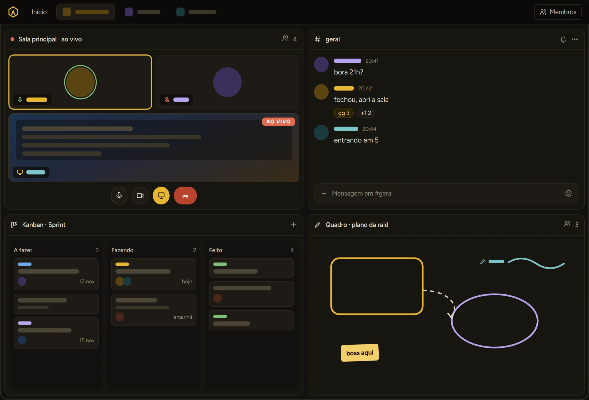

<p align="center">
  
</p>

<h1 align="center">Aureum</h1>

<p align="center">
  Voz, chat e quadros pra quem joga e trabalha junto.<br>
  <a href="https://eduoliveira1504.github.io/aureum-voice/"><b>eduoliveira1504.github.io/aureum-voice</b></a>
</p>



O Aureum é um app de conversa pra Windows e Mac, feito pra ficar aberto o dia todo com o seu grupo de
amigos ou o seu time:

- **Salas ao vivo:** a visão geral do servidor mostra quem está em cada sala e quem está falando, antes
  de você entrar.
- **Início:** um resumo do que importa agora: quem está em call, as menções e mensagens que você
  perdeu e as suas tarefas do Kanban, de todos os servidores.
- **Câmera e tela com áudio:** compartilhe a tela ou uma janela com o som do jogo junto.
- **Painel de sons:** cada servidor tem os seus sons curtos pra tocar na call, e cada um escolhe o
  volume ou silencia os dos outros.
- **Chat completo:** responder, encaminhar, reações, emojis, figurinhas (do Aureum e do seu
  servidor), GIFs, prévia de links e "Vista" nas conversas a dois.
- **Lado a lado:** chat e quadro Kanban na mesma tela.
- **Addons:** Kanban, quadro branco pra desenhar junto, enquetes no chat, eventos com lembretes e um
  calendário com os eventos e prazos do servidor.
- **Overlay nos jogos (Windows):** veja quem está falando sem sair da partida.
- **Chamada destacada:** tire a call do app numa janela própria, por cima dos outros programas, mesmo
  com o Aureum minimizado.
- **Do seu jeito:** avatar e banner animados (com recorte e zoom), pronomes, insígnias em destaque e temas, tudo de graça.

Sem anúncio e sem IA dentro do app.

## Como entrar no beta

O beta é aberto: é só baixar, instalar e criar a conta com e-mail e senha, sem convite. O app sai
pra Windows (10 e 11) e Mac (macOS 12 ou mais novo), e a
[página do Aureum](https://eduoliveira1504.github.io/aureum-voice/) já oferece o instalador do seu
sistema.

Quem testa durante o beta ganha a insígnia **Beta Tester**, que fica no perfil pra sempre.

### No Windows

1. Baixe o instalador na [página do Aureum](https://eduoliveira1504.github.io/aureum-voice/).
2. Abra e instale. O Windows pode avisar que o app é desconhecido (ele ainda não tem assinatura
   digital): clique em **Mais informações** e depois em **Executar assim mesmo**.
3. Crie a sua conta no app.

### No Mac

1. Baixe o `.dmg` certo: **arm64** pra Mac com chip Apple (M1 ou mais novo), **x64** pra Mac com Intel
   (veja em **Apple › Sobre este Mac**). Precisa do macOS 12 ou mais novo.
2. Abra o `.dmg` e arraste o **Aureum Voice** pra **Aplicativos**.
3. Na primeira vez o macOS avisa que não pode verificar o app (ele ainda não tem assinatura da Apple):
   clique em **OK**, vá em **Ajustes do Sistema › Privacidade e Segurança**, role até o fim e clique em
   **Abrir Mesmo Assim**. Se aparecer "está danificado e não pode ser aberto", rode no Terminal e abra
   de novo:

   ```sh
   xattr -cr "/Applications/Aureum Voice.app"
   ```

4. Crie a sua conta e libere o microfone e a câmera quando o Mac perguntar. Pra transmitir a tela,
   libere o Aureum em **Gravação de Tela e Áudio do Sistema** e abra o app de novo.

No Mac o app ainda não se atualiza sozinho: quando sair versão nova, aparece **Baixar a versão** no
topo do app. O overlay nos jogos e o "pressionar para falar" são só do Windows por enquanto.

No Windows o app se atualiza sozinho. Se o ícone antigo continuar aparecendo depois de uma atualização,
reinicie o PC (o Windows guarda o ícone em cache). As novidades de cada versão ficam no
[CHANGELOG](CHANGELOG.md).

Achou um problema? Use **Reportar problema** no app (Ctrl+Shift+R, ou Cmd+Shift+R no Mac) ou
[abra uma issue](https://github.com/eduoliveira1504/aureum-voice/issues/new).

## Licença

Todos os direitos reservados. O código fica visível só pra consulta e **não é open source**: não é
permitido copiar, modificar nem distribuir sem autorização por escrito. Detalhes no [LICENSE](LICENSE).

---

## In English

**Aureum** is a desktop communication app for groups of friends and small teams: voice rooms with a
live overview of who's talking, camera and **screen sharing with system audio**, a per-server
soundboard, chat, side-by-side panels with add-ons (Kanban board, whiteboard, polls, events with
reminders and a calendar), and an in-game overlay (Windows). No ads and no AI features.

It's a Windows and macOS app built with Electron + React + TypeScript, on a FastAPI + Postgres + Redis + MinIO
backend, with LiveKit for real-time media, and is built on open-source components. It's currently in a
closed, invite-only beta: the download is public, but you need an invite link to create an account.
The macOS version is experimental.

- Landing page: [eduoliveira1504.github.io/aureum-voice](https://eduoliveira1504.github.io/aureum-voice/)
- Architecture, local setup, tests and hosting: [docs/DEVELOPMENT.md](docs/DEVELOPMENT.md)
- Architecture decision records: [docs/decisions](docs/decisions)

## License

All rights reserved. The source code is visible for reference only and is **not open source**:
copying, modifying or redistributing it requires written permission. See [LICENSE](LICENSE).
